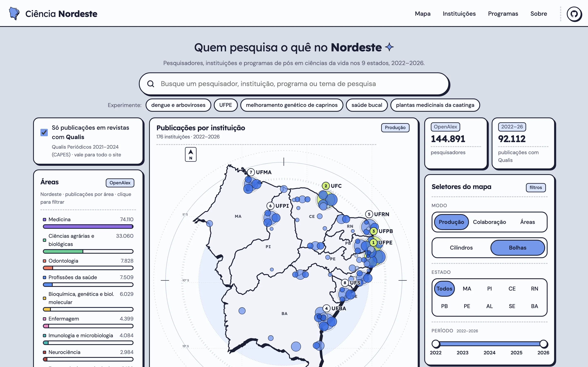
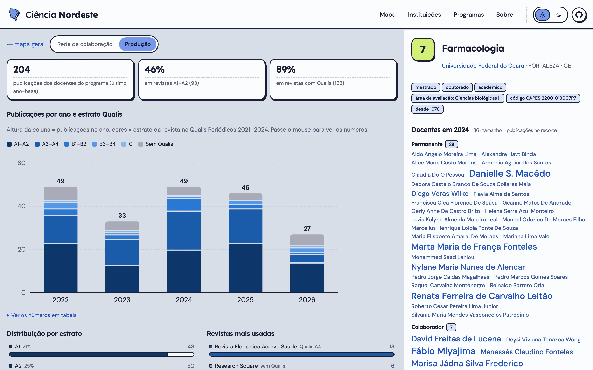
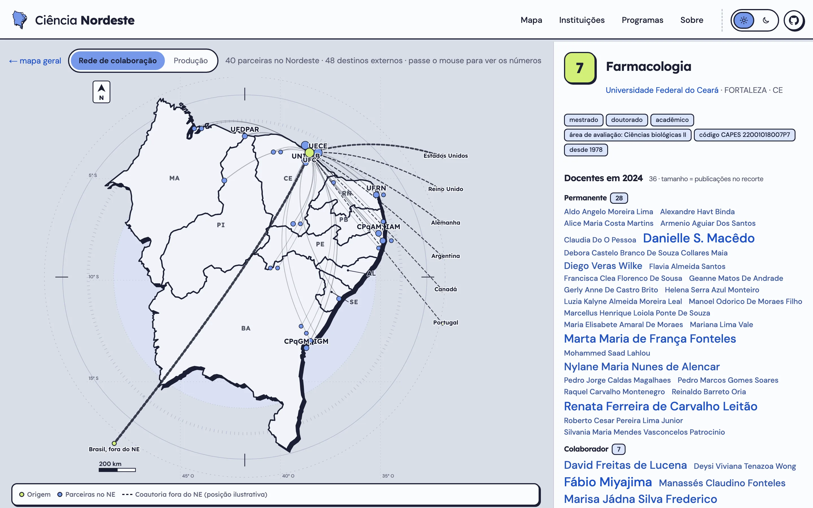
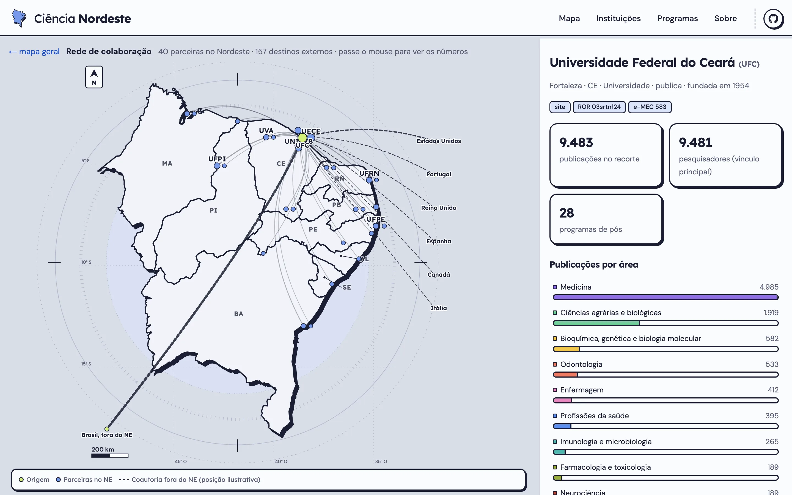
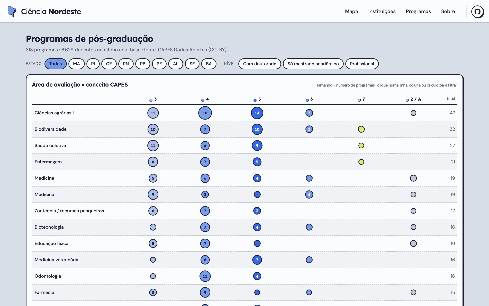

<p align="center">
  <picture>
    <source media="(prefers-color-scheme: dark)" srcset="assets/01-placa-horizontal-escuro.svg">
    
  </picture>
</p>

# Ciência Nordeste

Repositório aberto da pesquisa em **ciências da vida** do Nordeste: saúde, biomedicina, biotecnologia, genética, microbiologia, ciências agrárias e biológicas e veterinária. Reúne, a partir de **dados abertos**, instituições, programas de pós-graduação, pesquisadores, publicações (2022–2026), teses e colaborações dos nove estados da região.

## Telas

Site: **[ciencianordeste.com.br](https://ciencianordeste.com.br)**

<p align="center">
  
  <br><sub>Tela inicial: busca por pesquisador, instituição, programa ou tema, e mapa da produção por instituição.</sub>
</p>

<p align="center">
  
  <br><sub>Programa de pós-graduação, aba <b>Produção</b>: publicações por ano e estrato Qualis Periódicos 2021–2024 (D-033).</sub>
</p>

<table>
  <tr>
    <td width="50%"><br><sub>Aba <b>Rede de colaboração</b>: parceiras no Nordeste e coautorias externas.</sub></td>
    <td width="50%"><br><sub>Instituição: rede de colaboração, números e publicações por área.</sub></td>
  </tr>
  <tr>
    <td colspan="2"><br><sub>Programas de pós-graduação: área de avaliação × conceito CAPES, com filtros por estado e nível.</sub></td>
  </tr>
</table>

## Números atuais

| | |
|---|---|
| Instituições | 754 |
| Programas de pós-graduação | 313 |
| Pesquisadores | 144.891 (5.583 docentes de pós) |
| Publicações 2022–2026 | 111.164 |
| Teses e dissertações | 15.047 |

## Como rodar localmente

Guia completo, com requisitos, tempos e o que muda na reprodução: **[docs/rodar-localmente.md](docs/rodar-localmente.md)**.

**Requisitos:** Git, Docker com Compose v2, Python 3.12+, 8 GB de memória (16 GB recomendados), cerca de 25 GB livres em disco, um e-mail de contato e uma [chave gratuita do OpenAlex](https://openalex.org/settings/api). Node.js não é necessário (o app é compilado no Docker).

**Arquivo obtido à mão:** a planilha do Qualis Periódicos 2021-2024, exportada da [Plataforma Sucupira](https://sucupira-legado.capes.gov.br/sucupira/public/consultas/coleta/veiculoPublicacaoQualis/listaConsultaGeralPeriodicos.jsf), em `ingest/dados/brutos/capes/qualis/qualis-2021-2024.xlsx` (passo a passo no guia).

```bash
git clone https://github.com/gabrielvpina/ciencia-nordeste.git && cd ciencia-nordeste
cp .env.example .env                       # preencha POSTGRES_PASSWORD, CONTACT_EMAIL e OPENALEX_API_KEY
python3.12 -m venv .venv && .venv/bin/pip install -r ingest/requirements.txt
.venv/bin/pip install -r ingest/requirements-embeddings.txt   # opcional: busca por tema (ou use --sem-embeddings abaixo)
./scripts/atualizar_dados.sh               # ingestão completa + banco + app (~3–4 h); --sim mostra o plano
# site em http://localhost:3000
```

Depois disso:

```bash
docker compose up -d embed web             # sobe o site (o banco sobe junto)
./scripts/verificar.sh                     # lint, tipos, build e migrações num banco vazio (o mesmo que a CI)
./scripts/backup.sh                        # backup do que não se regenera + dump do banco (~/Backups/ciencia-nordeste)
```

Os números podem diferir um pouco dos do site publicado: as fontes são atualizadas continuamente, a revisão manual de identidade não está no repositório e os IDs internos são gerados na sua máquina. Detalhes na seção "Reprodutibilidade" do guia.

## Índice da documentação (`docs/`)

### Etapas executadas — [`docs/etapas/`](docs/etapas/)

| # | Etapa | Status |
|---|---|---|
| 0 | [Diagnóstico de disponibilidade e tamanho das fontes](docs/etapas/00-diagnostico-fontes.md) | concluída |
| 1 | [Instituições do Nordeste](docs/etapas/01-instituicoes.md) | concluída |
| 2 | [Programas de pós-graduação e docentes (CAPES)](docs/etapas/02-pos-graduacao-capes.md) | concluída |
| 3 | [Grupos de pesquisa](docs/etapas/03-grupos-de-pesquisa.md) | aguardando pedido LAI |
| 4 | [Pesquisadores e resolução de identidade](docs/etapas/04-pesquisadores.md) | concluída |
| 5 | [Produção científica (OpenAlex)](docs/etapas/05-producao.md) | concluída |
| 6 | [Complementos: teses e orientações, FAPs do NE, BDTD/Oasisbr](docs/etapas/06-complementos.md) | concluída (BDTD/Oasisbr só sondados) |
| 7 | [Fotos de pesquisadores](docs/etapas/07-fotos.md) | concluída (Commons) |
| 8 | [Revisão de identidade e consolidação](docs/etapas/08-revisao-identidade.md) | em uso; revisão manual pendente |
| 9 | [Banco de dados, migrações e CI](docs/etapas/09-banco-migracoes-ci.md) | concluída |
| 10 | [Aplicação web](docs/etapas/10-aplicacao-web.md) | núcleo concluído |
| 11 | [Mapa próprio do Nordeste](docs/etapas/11-mapa-proprio.md) | concluída |
| 12 | [Busca vetorial por tema de pesquisa](docs/etapas/12-busca-vetorial.md) | concluída |
| 13 | [Quiz "Que cientista é você?" e alinhamento a pesquisadores](docs/etapas/13-quiz-alinhamento.md) | em desenho (branch `quiz`) |

### Outros documentos

| Documento | Conteúdo |
|---|---|
| [docs/rodar-localmente.md](docs/rodar-localmente.md) | Requisitos, passo a passo de um clone até o site local e o que muda na reprodução da base |
| [docs/deploy/guia-deploy-ec2.qmd](docs/deploy/guia-deploy-ec2.qmd) | Publicação num servidor (AWS EC2, Docker, Caddy com HTTPS) e atualização do site |
| [docs/decisoes.md](docs/decisoes.md) | Registro de decisões técnicas, D-001 a D-035 (fontes, robots.txt, recorte, identidade, banco, app, mapa, interface, atualização dos dados, Qualis, tema claro) |
| [docs/pedido_lai_cnpq.md](docs/pedido_lai_cnpq.md) | Texto pronto do pedido de acesso à informação ao CNPq (grupos de pesquisa e bolsistas PQ) |

### Relatórios gerados (`ingest/relatorios/`, fora do git)

Saídas de cada etapa, geradas localmente ao rodar a ingestão (não são versionadas, D-026), com os números exatos de cada execução: `diagnostico_fontes`, `parte1_instituicoes`, `parte2_capes`, `parte4_pesquisadores`, `parte5_producao`, `parte6_complementos`, `parte7_fotos`, `parte9_qualis` (em `.md` e `.json`) e `revisao_consolidacao.json`. O diagnóstico nacional original está em `ingest/relatorios/arquivo/`.

## Fontes e licenças

OpenAlex (CC0), ROR (CC0), CAPES Dados Abertos (CC-BY), Qualis Periódicos 2021-2024 (CAPES/Sucupira, dados públicos), INEP e IBGE (dados públicos), Wikidata (CC0) e Wikimedia Commons (licenças livres por arquivo, com crédito). Sem dados da Plataforma Lattes nem do Google Acadêmico.

## O que está (e o que não está) no git

O repositório guarda **só código e documentação**. Dados, fotos, relatórios gerados, o registro de UUIDs estáveis (`ingest/dados/ids/`) e as decisões de revisão (`ingest/dados/revisao/decisoes.csv`) ficam apenas no disco (D-026). Os dois últimos **não são regeneráveis**: rode `./scripts/backup.sh` com frequência (e `./scripts/restaurar.sh PACOTE` para verificar ou restaurar). **Não faça `git checkout` de commits anteriores a `f9451a7` na pasta de trabalho**: isso sobrescreve e depois apaga esses arquivos (D-027).
